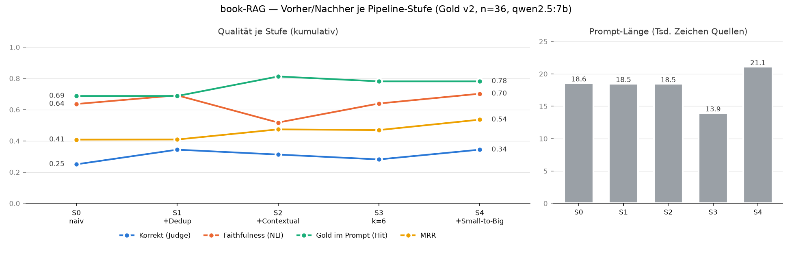
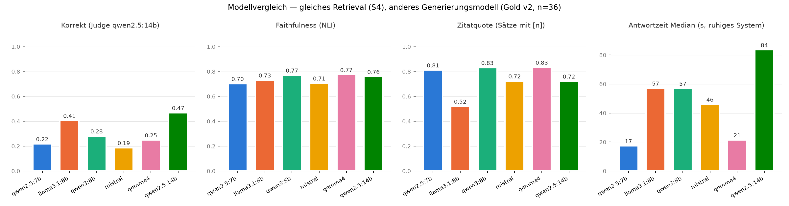
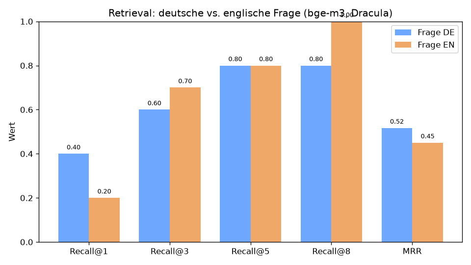
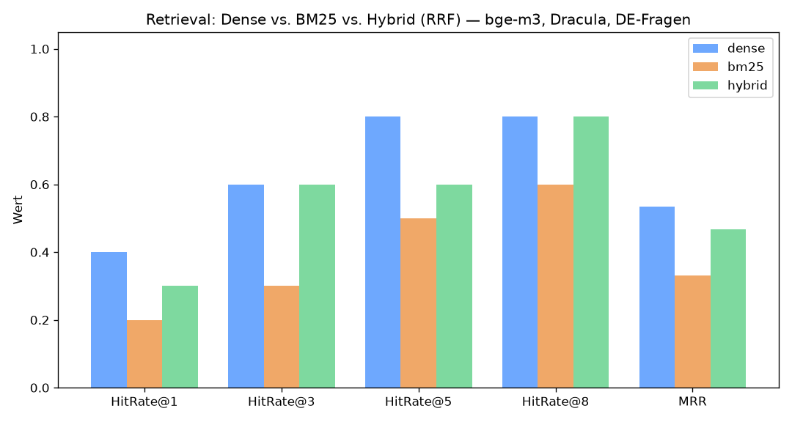
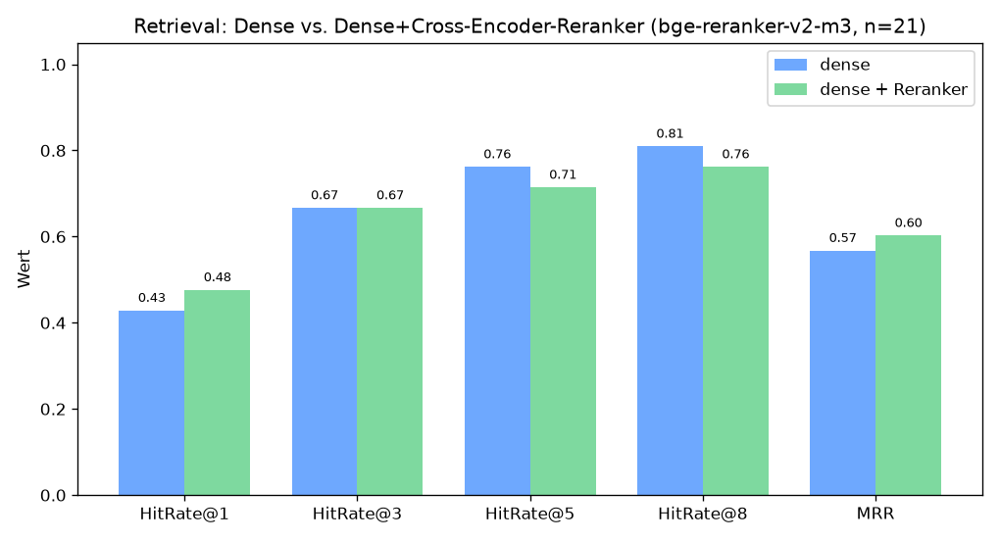
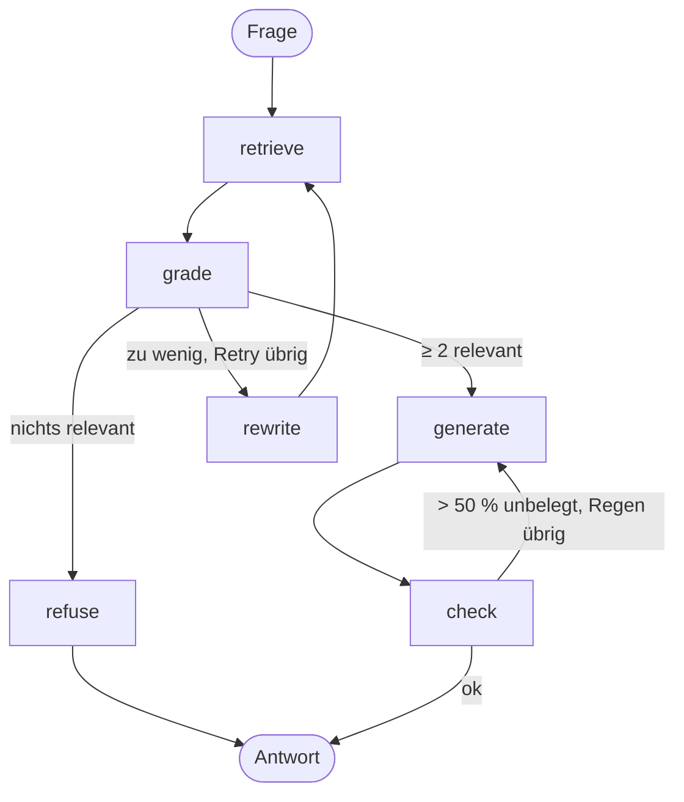
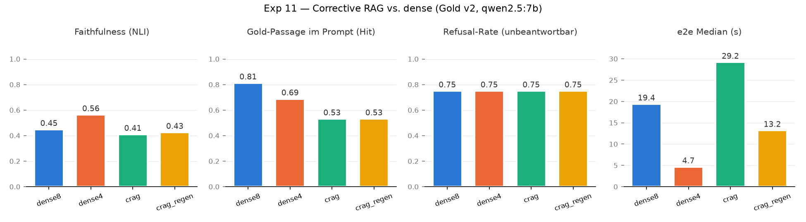

# book-RAG — Lokale RAG-Anwendung für Buchtexte mit Zitierung & Evaluation

Eine vollständig **lokal lauffähige Retrieval-Augmented-Generation-Anwendung**: Buchtexte
werden aufbereitet und indexiert, ein lokales LLM (via **Ollama**) beantwortet Fragen dazu —
**auf Deutsch, mit anklickbaren Zitier-Markern `[n]`**, die jede Aussage auf die konkrete
Quell-Passage zurückführen (Grounding & Erklärbarkeit). Kern des Projekts ist eine
**methodisch saubere, ehrliche Evaluation** der Retrieval- und Antwortqualität.

## Demo

Deutsche Frage → englischer Quelltext (cross-lingual) → gestreamte Antwort mit `[n]`-Zitaten;
Klick auf einen Marker zeigt die exakte Quell-Passage.

**Ablauf:** Frage eintippen → Antwort wird tokenweise gestreamt (TTFT sichtbar) → jede Aussage
trägt einen `[n]`-Marker → Klick auf einen Marker/Chip öffnet den zugehörigen Quell-Chunk mit
Buch, Kapitel und Ähnlichkeits-Score. Lokal reproduzierbar via `make up` (siehe Schnellstart).

## Architektur

```
Angular (minimal, Signals) ──REST + SSE──► FastAPI (Python 3.12)
 Chat · Dokumente · Modelle · Dashboard            │  RagService (Service-Schicht)
                                          ┌─────────┼──────────┐
                                          ▼         ▼          ▼
                                       Ollama     Qdrant    PostgreSQL
                                    Chat + bge-m3  Vektoren  (Metadaten · Chats · query_log)
```

- **Ollama** — lokales LLM (`qwen2.5:7b-instruct`) + Embeddings (`bge-m3`, multilingual)
- **FastAPI** — dünne Routen + `RagService` (retrieve → Prompt → Streaming → Zitat-Mapping)
- **Qdrant** — Vektor-Suche (Cosine) mit Metadaten-Filter (Gruppen/Bücher/Sammelgruppen)
- **PostgreSQL** — Gruppen/Bücher, Modell-Registry, gespeicherte Unterhaltungen, Anfrage-Log
- **Angular** — schlanke SPA (Standalone-Components, Signals, `@if/@for`), nginx-`/api`-Proxy für SSE;
  Views: Chat, Dokumente (Upload/Gruppen), Modelle (Metadaten), Dashboard (Live-Telemetrie)
  — Apple-nahes Designsystem auf Tailwind-Tokens (hell/dunkel, responsiv; siehe [`frontend/DESIGN.md`](frontend/DESIGN.md))
- **Notebooks/Skripte** — die komplette Evaluations-Suite (`eval/`, `notebooks/`)

## Features

- Robuste **Ingestion-Pipeline**: Encoding-Sniffing, Gutenberg-Boilerplate-Strip, deterministische
  **Textbereinigung** (De-Wrapping, Zeichen-Normalisierung) mit **Dry-Run-Prüf-Gate**, strukturbewusstes
  Chunking (Kapitel + Offsets auf bereinigtem Text), Input-Validierung vor dem Embedden.
- **Upload-UI mit Gruppen**: Texte im Browser hochladen (Dry-Run-Report → Commit), in Gruppen
  (Genre/Franchise) organisieren; Slugs entstehen automatisch aus dem Namen.
- **Sammelgruppen**: mehrere Gruppen unter einem Namen bündeln (z. B. „Fantasy" = GoT + Harry
  Potter) — **ohne Re-Ingestion**; der Slug expandiert beim Retrieval zu einem
  Qdrant-`MatchAny`-Filter über die Mitglieds-Gruppen.
- **Grounding via Zitat-Contract**: nummerierte Quellen im Prompt, `[n]` wird **serverseitig** auf
  Chunk-IDs gemappt (halluzinierte Marker werden verworfen); Quell-Passagen werden mit der
  Unterhaltung **persistiert** und bleiben beim Wiederöffnen lesbar.
- **Gespeicherte Chats mit Verlauf**: Unterhaltungen in Postgres, Sidebar nach Gruppen gebündelt;
  **History-aware Retrieval** (Folgefragen werden per LLM zu eigenständigen Suchanfragen kondensiert).
- **Cross-linguales Retrieval** (deutsche Fragen, englische Texte) via `bge-m3`.
- **Dashboard**: Live-Telemetrie aus dem `query_log` — Anfragen, Ø TTFT, Ø TPS pro Modell,
  inkl. Vergleichs-Barplots; Modell-Metadaten (Parameter, Quantisierung, Kontext) aus Ollama.
- **Optionale Qualitäts-Services** (opt-in): Cross-Encoder-**Reranker** (`bge-reranker-v2-m3`)
  und **NLI-Faithfulness-Check**, der ungestützte Zitate im Frontend mit ⚠ markiert.
- **Contextual Ingestion** (opt-in, `CONTEXTUAL_INGEST_ENABLED`): Beim Ingest generiert das
  LLM pro Chunk 1–2 Sätze Kontext (Pronomen aufgelöst), die nur ins Embedding eingehen —
  **stärkster gemessener Retrieval-Hebel** (Exp 5: MRR +0.182). Bestehende Bücher lassen
  sich ohne Originaldatei umstellen (`app.ingestion.reembed_cli`).
- **Serving-Metriken** pro Anfrage: TTFT, TPS, Tokens.

## Schnellstart (macOS, Apple Silicon)

Voraussetzungen: Docker, Ollama, [`uv`](https://docs.astral.sh/uv/).

```bash
cd book-RAG
make ollama-host          # EINMALIG (macOS): OLLAMA_HOST=0.0.0.0 -> danach Ollama-App neu starten
make ollama-ctx           # EINMALIG: Kontextfenster 16k — sonst schneidet Ollama RAG-Prompts bei 4096 Token ab!
make models               # EINMALIG: bge-m3 + qwen2.5:7b ziehen
make up                   # Qdrant + Backend + Frontend starten
make ingest               # Demo-Buch (Public Domain) ingesten
# -> Frontend: http://localhost:4200   Backend: http://localhost:8001/health
```
`make down` stoppt alles, `make clean` entfernt auch Volumes/Images/Caches, `make help` listet alle Targets.

> **macOS-Hinweis:** Docker-Container erreichen das Host-Ollama nur, wenn es auf `0.0.0.0` lauscht
> (`make ollama-host` + Ollama-App-Neustart). Das ist der einzige manuelle Einmalschritt.

## Evaluation (der Kern)

Alle Experimente sind reproduzierbar (`eval/`), gegen ein handgelabeltes **Gold-Set v2**
(`eval/gold_v2.jsonl`, **n=36**: 26 Fakten-, 3 Paraphrase-, 3 Multi-Hop-, 4 unbeantwortbare
Fragen) mit passagen-genauen Span-Labels, kuratiert in
[`notebooks/gold_set_v2.ipynb`](notebooks/gold_set_v2.ipynb). Volle Ergebnisse, vorab notierte
Hypothesen und Methodik-Caveats: [`eval/RESULTS.md`](eval/RESULTS.md).

> **Ehrlichkeits-Hinweis:** n=36 aus einem Buch — die meisten Paarvergleiche sind nicht
> signifikant; die Zahlen sind Trends, keine belastbaren Rankings.

### Vorher/Nachher: was jede Pipeline-Stufe bringt (`make eval-ablation`)

Alle Stufen kumulativ in **einem** Lauf unter identischen Bedingungen (qwen2.5:7b, temp 0,
num_ctx 16384). Reproduzierbarkeit geprüft: S2/S3 treffen die Exp-10-Werte exakt.



| Stufe | Gold im Prompt (Hit) | MRR | Faithfulness (NLI) | Korrekt (Judge) | Prompt (Zeichen) |
|---|---|---|---|---|---|
| S0 naiv (Text-Embeddings, k=8) | 0.69 | 0.41 | 0.64 | 0.25 | 18,6 k |
| S1 +Overlap-Dedup | 0.69 | 0.41 | 0.69 | 0.34 | 18,5 k |
| S2 +Contextual Retrieval | **0.81** | 0.47 | 0.52 | 0.31 | 18,5 k |
| S3 k=6 | 0.78 | 0.47 | 0.64 | 0.28 | 13,9 k |
| S4 +Small-to-Big | 0.78 | **0.54** | **0.70** | **0.34** | 21,1 k |

**Was die Kurve zeigt:**
- **Retrieval wird messbar besser:** Die antwort-tragende Passage steht in 81 statt 69 % der
  Fragen im Prompt, die Rangposition (MRR) steigt von 0.41 auf 0.54 — vor allem durch
  Contextual Retrieval und Small-to-Big.
- **Die Antworten werden kaum besser:** Korrekt laut Judge 25 → 34 %, und selbst **wenn die
  richtige Passage im Prompt steht, ist nur etwa jede dritte Antwort korrekt.** Der Engpass ist
  nicht mehr das Retrieval, sondern das 7B-Generierungsmodell — der nächste Hebel ist das Modell,
  nicht eine weitere Retrieval-Technik.
- **Modellvergleich bestätigt das** (`make eval-models`, gleiches Retrieval, 6 lokale Modelle):
  ein anderes Generierungsmodell bringt bis zu +0,25 Korrektheit — mehr als alle Retrieval-Stufen
  zusammen. Aber jedes Modell hat einen Haken (siehe unten); Default bleibt qwen2.5:7b.
- **Messfehler gefunden und behoben:** Die NLI-Faithfulness schnitt Passagen bei 512 Token ab
  (98–100 % betroffen); Small-to-Big fiel dadurch scheinbar auf 0.34. Gefenstert gemessen liegt
  es bei 0.70. Faithfulness-Zahlen aus Exp 10/11 (unten) sind noch abgeschnitten gemessen —
  innerhalb eines Experiments vergleichbar, absolut zu niedrig.

### Modellvergleich: gleiches Retrieval, anderes Generierungsmodell



| Modell | Korrekt (Judge 14b / 7b) | Zitatquote | Unbeantwortbar verweigert | Fälschlich verweigert | Antwortzeit |
|---|---|---|---|---|---|
| **qwen2.5:7b** (Default) | 0.22 / 0.34 | 0.81 | 3/4 | 0 | **17 s** |
| llama3.1:8b | 0.41 / **0.47** | 0.52 | **4/4** | 0 | 57 s |
| qwen3:8b | 0.28 / 0.44 | **0.83** | **4/4** | 6/32 | 57 s |
| mistral 7b | 0.19 / 0.34 | 0.72 | 2/4 | 1/32 | 46 s |
| gemma4 | 0.25 / 0.31 | **0.83** | **4/4** | 1/32 | 21 s |
| qwen2.5:14b | **0.47 / 0.47** | 0.72 | 1/4 | 1/32 | 84 s |

Kein Modell gewinnt überall: qwen2.5:14b ist am korrektesten, erfindet aber eher Antworten auf
Unbeantwortbares und ist 5× langsamer; llama3.1:8b zitiert nur jeden zweiten Satz. Zwei Judges
(Kappa 0.39) — Korrektheit als Tendenz lesen. Details: `eval/RESULTS.md`.

### Was ich untersucht habe (und was die Daten *wirklich* sagen)

**1. Deutsche vs. englische Frage** — Hypothese: der cross-linguale Gap ist der Flaschenhals.
→ **Teilweise widerlegt:** `bge-m3` ist echt multilingual (DE rankt den Top-Treffer sogar besser);
Query-Übersetzung ist **kein** Fix.



**2. Dense vs. BM25 vs. Hybrid (RRF)** — *adversariell verifiziert* durch ein 4-Skeptiker-Panel,
das meinen ersten (zu optimistischen) Entwurf korrigierte (mislabeled Metrik + latenter Bug).
→ **Naives RRF-Hybrid bringt keinen belastbaren Netto-Vorteil** (gepaarte Bilanz 4:4); BM25 solo
am schwächsten, aber cross-lingual gehandicapt.



**3. Cross-Encoder-Reranker** (`bge-reranker-v2-m3`) → verbessert **Precision@1 (+0.05) und MRR
(+0.035)** (bringt einen Treffer nach vorn) — die kapitel-basierte Metrik unterbewertet den
passagen-basierten Reranker allerdings systematisch.



### Antwortqualität (Metrik-Suite, `eval/answer_eval.py`)

Pro Frage wird die volle RAG-Pipeline ausgeführt und gemessen: **ROUGE-L**, **Antwort-Token-F1**,
**Faithfulness** (Entailment via `mDeBERTa-xnli`, bewusst statt PPL), **Recall@k/MRR**, **TTFT/TPS**.

| Kategorie | Metrik | k=8 (Default) | k=6 | k=4 |
|---|---|---|---|---|
| Antwort | ROUGE-L | 0.172 | 0.185 | 0.173 |
| Antwort | Antwort-Token-F1 | 0.197 | 0.217 | 0.207 |
| Antwort | **Faithfulness (NLI)** | **0.448** | **0.505** | **0.564** |
| Ehrlichkeit | Refusal-Rate (unanswerable) / False-Refusal | 0.75 / 0.00 | 0.75 / 0.00 | 0.75 / 0.00 |
| Retrieval | Hit-Rate@k (span) | **0.812** | 0.781 | 0.688 |
| Retrieval | MRR (span) | **0.474** | 0.469 | 0.451 |
| Serving | e2e (median) | 16 s | 10 s | 8 s |

<sub>Gold v2, n=36 (32 beantwortbar), span-basiert, `num_ctx` 16384 — Exp 10 in `eval/RESULTS.md`.
Eine früher hier berichtete Faithfulness von 0.667 war ein Artefakt: Ollama kürzte die Prompts
still auf 2050 Token, das Modell sah nur die letzten ~2 Passagen (s. Exp 7/10).</sub>

**Trade-off, den die Suite sichtbar macht:** Mehr Passagen verbessern das Retrieval nur bis
k=8, senken aber die Stützung der Antwort monoton — ein 7B-Modell verliert mit jeder weiteren
Passage Verankerung. Empfehlung: `TOP_K=6` (Exp 10).

**Kernbeobachtung:** ROUGE-L/F1 sind niedrig, obwohl die Antworten korrekt sind — sie messen nur
n-Gramm-**Oberflächenüberlappung** und bestrafen Paraphrasen. **Faithfulness (NLI)** ist für ein
generatives RAG-System das aussagekräftigere Qualitätsmaß (misst *Stützung*, nicht Wortgleichheit).

## Design-Entscheidungen

- **Ollama statt vLLM:** läuft nativ (Metal) auf Apple Silicon; ein Prozess für Chat + Embeddings.
- **`bge-m3` (Embeddings):** multilingual → deutsche Fragen gegen englische Texte, ohne `torch`-Abhängigkeit im Backend.
- **Service-Schicht (`RagService`):** Geschäftslogik gekapselt, Routen dünn (OOP + KISS).
- **Faithfulness statt PPL:** Perplexität misst Fluenz, nicht Korrektheit/Grounding.
- **Sofort-public Repo:** strikte History-Hygiene (nur Public-Domain-Demotext; geschützte Texte bleiben lokal).

**Optional: Cross-Encoder-Reranker** (`bge-reranker-v2-m3`) **und NLI-Faithfulness-Check**
(`mDeBERTa-xnli`). Standardmäßig aus (hält das Image schlank); lokal via `uv sync --group reranker`
+ `RERANKER_ENABLED=true` / `FAITHFULNESS_CHECK_ENABLED=true`. Dann holt Dense
`RERANK_CANDIDATES` (30) Kandidaten, der Reranker sortiert sie neu und gibt die Top-`TOP_K` ans LLM;
der Faithfulness-Check markiert Zitate, die die Quelle laut NLI nicht stützt (⚠ im Frontend).
Beide Modelle laden lazy und laufen im Thread. Status unter `GET /health`.

**Optional: Small-to-Big** (`SMALL_TO_BIG_ENABLED=true`): Die Suche bleibt auf den kleinen,
präzisen Chunks; die besten `S2B_TOP_N` (3) Treffer werden vor dem Prompt-Bau um ± `S2B_WINDOW` (1)
Nachbar-Chunks erweitert — per deterministischer Punkt-ID direkt aus Qdrant, Overlap exakt über
char-Offsets zusammengefügt, kein Re-Embedding. Exp 7: Die antwort-tragende Passage steht damit
deutlich öfter in Quelle [1] (MRR 0.474 → 0.540, kein Item schlechter), Kosten +36 % Prompt-Länge
(→ vorher `make ollama-ctx`, sonst schneidet der Runner den Prompt ab).

**Optional: Corrective RAG mit LangGraph** (`CRAG_ENABLED=true`, Chat-Request `mode=crag`,
`backend/app/flow/`): Ein Grader bewertet die Treffer. Bei zu wenig Relevantem wird die Anfrage
umgeschrieben und neu gesucht. Generiert wird nur mit relevanten Passagen; ist nichts
relevant, wird ehrlich verweigert. Mit aktivem Faithfulness-Check wird eine Antwort mit zu vielen
unbelegten Zitaten einmal streng neu generiert (das Frontend leert die Bubble per SSE-`reset`).



**Gemessen (Exp 11, negativ):** Faithfulness 0.410 statt 0.448 (dense8), klar unter der
billigen Kontrolle k=4 (0.564); die Gold-Passage steht nur noch bei 53 % statt 81 % der Fragen im
Prompt. Ursache ist der 7B-Grader (Precision 0.22, Recall 0.55 gegen die Span-Labels). Der Modus
bleibt deshalb opt-in (Chat-Schalter „Prüfen“), der Default bleibt der lineare Pfad.
**Exp 11b** (Grader nur als Retry-Auslöser, Treffer mischen statt filtern): der Schaden ist weg,
ein Nutzen aber nicht messbar (Faithfulness 0.449 vs. 0.448, gepaart 3:1:27) — bei 2,3-facher
Antwortzeit. Ist CRAG eingeschaltet, nutzt es diese unschädliche Variante (`CRAG_STRATEGY=trigger`).



**Warum LangGraph, aber kein LangChain?** LangChain ist eine Baustein-Bibliothek (Modell-Wrapper,
Vektorspeicher, Retriever, Splitter), LangGraph eine Orchestrierungs-Laufzeit (Zustand, bedingte
Kanten, **Schleifen**, Streaming). Die Bausteine dieses Projekts sind bewusst eigene und
durchgemessen: Overlap-Dedup, Small-to-Big über deterministische Punkt-IDs und char-Offsets,
Kontext nur im Embedding, `MatchAny`-Sammelgruppen. Alle Eval-Skripte rufen genau diese Funktionen
auf. Ein Umbau auf LangChain-Abstraktionen hätte jede Zahl aus Exp 1–10 entwertet, ohne neue
Fähigkeit. Die lineare Pipeline bleibt deshalb ein schlichter Service. LangGraph kommt nur dort zum
Einsatz, wo der Ablauf tatsächlich verzweigt und sich wiederholt; die Knoten sind dünne Wrapper um
die vorhandenen Funktionen (Abhängigkeit: `langgraph` + `langchain-core`, keine LangChain-Integrationen).

## Projektstruktur

```
backend/    FastAPI (routes/ · services/ · rag/ · flow/ (LangGraph) · graph/ · ingestion/ · clients/ · db/)
frontend/   Angular (chat/ · groups/ · models/ · dashboard/ · shell/ · ui/ · services), nginx-Proxy
eval/       Gold-Set + Experimente (retrieval/lang/hybrid/reranker/answer) + RESULTS.md
notebooks/  DS-Notebooks (Gold-Set v2: Span-Labels, PCA-Karte, Wortwolken)
results/    Charts & Roh-Ergebnisse
benchmark/  Serving-Benchmark (Ollama vs. llama-server)
docs/       Projektplan
```

## Git-Workflow & Sicherheit

Git Flow: `main` (stabil) ← `develop` (Integration) ← `feature/*`. Commits auf Deutsch.
**Nie committet:** Buchtexte, Datenbanken, Vektorstore, Modelle, Secrets (`.gitignore` + Pre-Commit-Hooks
`gitleaks`/`nbstripout`). Urheberrechtlich geschützte Texte (z. B. Game of Thrones) bleiben ausschließlich lokal.

## Grenzen & Roadmap

- ~~Gold-Set v2 mit Span-Labels~~ ✅ kuratiert (36 Items); alle Eval-Skripte messen span-basiert.
  Ausbau auf n≥50 bleibt sinnvoll (Exp 8 zeigt: 25 von 32 Items bewegen sich gar nicht).
- ~~Contextual Retrieval~~ ✅ gemessen + produktiv (Exp 5, stärkster Hebel: span-MRR +0.054).
- ~~Sparse-Hybrid (bge-m3)~~ ✅ gemessen — ehrliches Negativ-Ergebnis (Exp 6), nicht in der Pipeline.
- ~~Small-to-Big~~ ✅ gemessen (Exp 7, MRR 0.474→0.540), opt-in `SMALL_TO_BIG_ENABLED`.
- **Graph-RAG** (`backend/app/graph/`, opt-in `GRAPH_RAG_ENABLED`): Entity-Graph aus einer
  LLM-Extraktion je Chunk. **Exp 8 (lokal, Entity-Linking / Nachbar-Expansion): kein messbarer
  Effekt** auf der Span-Metrik (paired 4:3:25). **Exp 9 (global, Louvain-Communities +
  LLM-Berichte für thematische Fragen, eigenes Gold-Set + LLM-Judge + NLI): negativ** —
  Berichte aus einer 7B-Extraktion sind Entity-Listen statt Themen, die Antworten werden
  länger und schlechter zitiert, nicht besser; ein 7B degeneriert bei 9k-Token-Prompts.
  Beides bleibt opt-in im Code, das Flag bleibt aus. Hypothesen vorab, Zahlen und Interpretation
  in `eval/RESULTS.md`.
- **Corrective RAG** (`backend/app/flow/`, LangGraph, opt-in `CRAG_ENABLED` + Chat-Schalter):
  **Exp 11 negativ** — ein per Prompt gesteuerter 7B-Grader filtert zu viele richtige Passagen weg.
  **Exp 11b neutral** (Grader nur als Retry-Auslöser: kein Schaden, kein Nutzen, 2,3 × Latenz).
- Bewusst minimal (lokales Projekt): kein Auth/CORS/Rate-Limiting.
- ~~Reranker in die `/chat`-Pipeline integrieren~~ ✅ umgesetzt (opt-in, s. o.).
- ~~Ingestion-UI, Gruppen-Verwaltung, Modellwechsel-UI~~ ✅ umgesetzt.

## Lizenz

[MIT](LICENSE). Demo-Texte von [Project Gutenberg](https://www.gutenberg.org).
